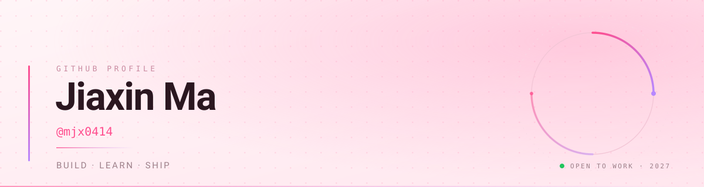

 

**大四在读 · 从基础开始,把东西做出来**

## 速览

|          |                                                              |
| :------- | :----------------------------------------------------------- |
| 身份     | 大四学生,**2027 届**                                          |
| 目标     | 一份能持续成长的工作                                          |
| 现在     | 补基础,做第一个完整的项目                                      |
| 节奏     | 每周至少 3 次提交                                             |
| 联系     | [开 Issue](https://github.com/mjx0414/mjx0414/issues) 优先    |

## 学习路线

进度对所有人公开 —— 做完一项才打勾,不打提前量。

- [x] 工具链:Git · 命令行 · 编辑器
- [ ] 语言基础:语法 · 调试 · 读懂报错
- [ ] 数据结构与算法
- [ ] 数据库与 SQL
- [ ] 第一个能演示的项目
- [ ] 部署上线,让别人能点开

## 工具

  
  
  
  

<!-- 语言与框架等写进真实项目后再加,只列真正写过的:

  
-->

## 联系

- 校招 / 实习 / 技术交流:开一个 [Issue](https://github.com/mjx0414/mjx0414/issues) 就行
- 邮箱:<!-- 填你的邮箱,校招 HR 基本不点 Issue -->
- 个人站点:[mjx0414.github.io](https://mjx0414.github.io)

<!-- ============ 有项目之后,取消下面这段的注释 ============

## 项目

| 项目 | 一句话 |
| :-- | :-- |
| [repo-name](https://github.com/mjx0414/repo-name) | 它解决了什么问题,做完之后能做到什么 |

每个项目的 README 写清四件事:
1. 这是在解决什么问题
2. 怎么跑起来(三条命令以内)
3. 做了什么取舍,为什么
4. 结果是什么(截图、数据、或者一句"能用了")

================================================================ -->
